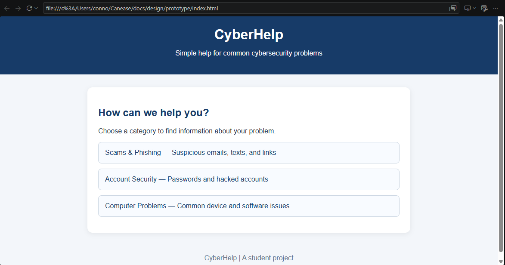
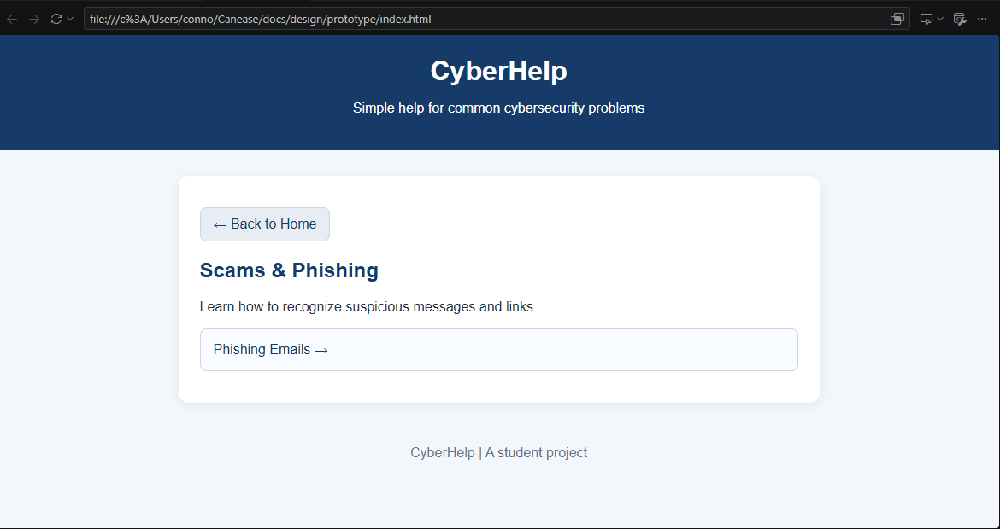
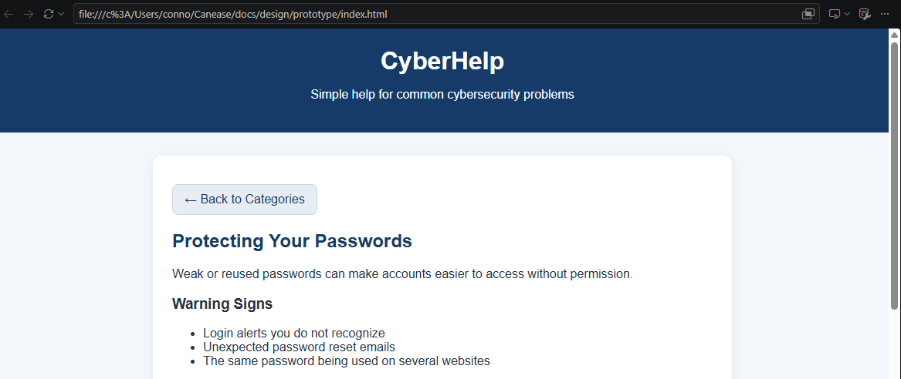
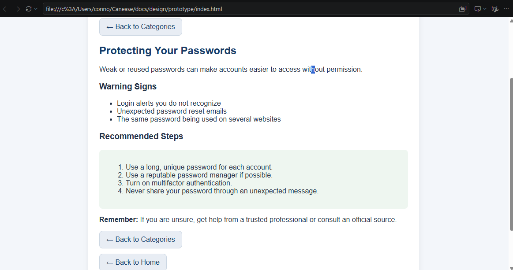

# CyberHelp — Research

## 1. Competitive Analysis

I looked at three websites that provide cybersecurity information or support: the Federal Trade Commission (FTC), the Cybersecurity and Infrastructure Security Agency (CISA), and Norton. These websites helped me identify features that could make CyberHelp useful for people who need simple technical information.

### Competitor 1: Federal Trade Commission (FTC)

**Website:** https://consumer.ftc.gov/

**What it does:**

- Provides information about scams and cybersecurity problems.
- Gives users steps to take when something goes wrong.
- Covers topics such as phishing, hacked accounts, and tech support scams.

**Interaction flow:**

1. The user searches for a problem or browses available information.
2. The user opens an article about the problem.
3. The user reads the explanation and warning signs.
4. The user follows the recommended steps.

**What CyberHelp can learn from it:**

- Information should include clear steps that users can follow.
- Users should be able to understand what to do next.
- Organizing information into categories can make it easier to find relevant help.

### Competitor 2: Cybersecurity and Infrastructure Security Agency (CISA)

**Website:** https://www.cisa.gov/secure-our-world

**What it does:**

- Provides cybersecurity advice for the general public.
- Covers topics such as software updates, passwords, and online safety.
- Offers tips and guidance for protecting personal information and devices.

**Interaction flow:**

1. The user visits the website.
2. The user chooses a security topic.
3. The user reads the advice.
4. The user follows the recommended actions.

**What CyberHelp can learn from it:**

- Information should be simple and easy to understand.
- Topics should use clear names that make sense to beginners.
- Advice should include practical actions users can take.

### Competitor 3: Norton

**Website:** https://support.norton.com/

**What it does:**

- Provides cybersecurity information and technical support.
- Offers search and different help categories.
- Provides information about scams, malware, passwords, and other security problems.

**Interaction flow:**

1. The user visits the support website.
2. The user searches for a problem or chooses a help topic.
3. The user reads the available instructions.
4. The user follows the recommended steps.

**What CyberHelp can learn from it:**

- Search can be useful when users know what they are looking for.
- Cybersecurity websites need to cover different types of problems.
- Presenting information in manageable sections can help prevent users from feeling overwhelmed.

### Competitive Analysis Summary

The three competitors provide useful cybersecurity information through articles, topics, search features, and instructions. However, CyberHelp can focus on keeping the experience simple for beginners by organizing common problems into categories and providing short explanations, warning signs, and recommended steps.

The main features I want CyberHelp to focus on are simple navigation, easy-to-understand information, and clear instructions for what users should do next.

---

## 2. User Interviews and Survey

I used three questions to explore how people currently find help with cybersecurity and computer problems, what makes finding help difficult, and what features they would want in a website like CyberHelp.

### Questions

**Question 1 — Current Behavior**

When you have a cybersecurity or computer problem, what do you normally do to find help?

**Question 2 — Pain Points**

What is the most difficult or frustrating part about finding help?

**Question 3 — Desired Features**

What would you want a website like CyberHelp to have that would make finding help easier?

### Person 1 — Layne

**Question 1 — Current Behavior**

Usually I just Google it or ask somebody I know who is better with computers. Sometimes I'll watch a YouTube video if I can't figure it out.

**Question 2 — Pain Points**

A lot of the websites use words I don't really understand. Sometimes there are a bunch of different answers and I don't know which one to trust.

**Question 3 — Desired Features**

I'd want it to be simple and tell me what the problem probably is and what I should do. It would also be nice if I didn't have to read a huge article.

### Person 2 — Devin

**Question 1 — Current Behavior**

I usually search online or ask a friend or family member. If it's something with my computer, sometimes I'll just take it to somebody who knows more about computers.

**Question 2 — Pain Points**

It's hard to know if the information online is actually right. Some websites make things sound more complicated than they need to be.

**Question 3 — Desired Features**

I'd like to be able to pick what kind of problem I'm having and then see the answer. Having steps to follow would be helpful too.

### User Research Findings

**How people currently find help**

The responses indicate that people may search online, watch videos, or ask friends and family when they have computer or cybersecurity problems.

**Main problems people experience**

- Technical information can be confusing.
- Different websites can provide different answers.
- It can be difficult to know which information to trust.
- Long articles can make it harder to find the information someone needs.

**Features people want**

- Simple explanations.
- Organized categories and topics.
- Clear steps to follow.
- Information that is easy to find and understand.

**Changes suggested for CyberHelp**

CyberHelp should keep explanations simple, organize problems into categories, and provide clear recommended steps. The website should also use reliable sources so users have a better idea of where the information comes from.

---

## 3. Technical Feasibility Check

CyberHelp is technically feasible because the first version will be a simple website with a limited number of features.

### Technology

The application can use the following technologies:

- **HTML:** Provides the structure and content of the website.
- **CSS:** Controls the layout, colors, spacing, and overall appearance.
- **JavaScript:** Allows users to interact with categories, topics, and navigation buttons.

These technologies are sufficient for creating the initial prototype without requiring a complicated backend.

### Hosting

The website can be hosted using GitHub Pages. This would allow the project to be published from the GitHub repository without requiring a separate application server.

### Features That Are Feasible

The following features should be manageable within the course timeframe:

- A homepage with help categories.
- Category and topic selection.
- Information about common problems.
- Warning signs and recommended steps.
- Back buttons and basic navigation.
- Helpful messages when information is unavailable.
- Responsive design for different screen sizes.
- Basic accessibility features.

A search bar could be added later if users need another way to find information.

### Features Not Needed for the First Version

The initial version does not need:

- User accounts.
- A database.
- Live cybersecurity scanning.
- Automatic malware detection.
- Payments or subscriptions.
- Password collection.
- Remote computer access.

Leaving out these features will keep the project manageable and reduce unnecessary complexity.

### Technical Conclusion

CyberHelp can be built as a simple website using HTML, CSS, and JavaScript. GitHub Pages can be used for hosting, and the initial version can focus on providing organized information and basic navigation. Keeping the project small will make it easier to complete and test within the course timeframe.

---

## 4. Summary of Research Findings

The competitive analysis shows that existing websites already provide useful cybersecurity information. CyberHelp can focus on making common information easier for beginners to find and understand.

The user research suggests that people may struggle with complicated explanations, conflicting information, and finding clear instructions.

Based on these findings, CyberHelp should:

- Use categories to organize information.
- Keep explanations short and simple.
- Include common warning signs.
- Provide clearly labeled recommended steps.
- Make navigation easy to understand.
- Use reliable sources for cybersecurity guidance.
- Avoid unnecessary features in the first version.

These findings support the original idea of creating one simple place where users can find help with common cybersecurity and technical problems.

---

## 5. Prototype

### Prototype Goal

The goal of the prototype is to test whether users can move through CyberHelp and find useful information about a cybersecurity problem.

The main interaction flow is:

**Home → Category → Topic → Problem Information → Recommended Steps**

The prototype focuses on the basic user experience rather than advanced functionality.

### Screen 1 — Home

The homepage introduces CyberHelp and allows users to choose a category.

**Title:** CyberHelp

**Description:** Find help for common cybersecurity and technical problems.

**Categories:**

- Scams & Phishing
- Account Security
- Computer Problems
- Online Safety

Each category should have a clear name and, where appropriate, a short description.

### Screen 2 — Category

The Scams & Phishing category contains topics related to suspicious messages and scams.

**Topics:**

- Phishing Emails
- Scam Text Messages
- Tech Support Scams

The user selects a topic to learn more about the problem.

### Screen 3 — Problem Information

**Topic:** Phishing Emails

**What is it?**

A phishing email is a message designed to trick someone into clicking a link, opening an attachment, or sharing personal information.

**Warning Signs:**

- An unexpected message.
- An urgent request or threat.
- A suspicious link.
- A request for personal or financial information.

The information should be presented in short sections so users can find the details they need without reading a long article.

### Screen 4 — Recommended Steps

**Heading:** What Should I Do?

1. Do not click suspicious links or open unexpected attachments.
2. Do not provide passwords or personal information in response to a suspicious message.
3. Contact the company through its official website or a phone number you already know is legitimate.
4. Report or delete the message if appropriate.

The page should include a clearly labeled Recommended Steps section and Back buttons so users can return to the category or homepage.

---

## 6. Prototype Evaluation

The purpose of the evaluation is to determine whether users can find a cybersecurity topic, understand the information, and locate the recommended steps.

The following observations document the initial evaluation. They should reflect what actually happened when the prototype was tested.

### Observation 1

**Person:** Layne

**Task:** Find information about a phishing email.

**What happened:**

The user was able to find the Scams & Phishing category and then select Phishing Emails.

**Problem noticed:**

The user was not sure which category to choose at first.

**Possible change:**

Use clearer category names and add a short description under each category.

### Observation 2

**Person:** Devin

**Task:** Find the recommended steps for a cybersecurity problem.

**What happened:**

The user found the phishing email information but had to look through the page to find the recommended steps.

**Problem noticed:**

The recommended steps were not easy to locate.

**Possible change:**

Put the instructions under a clearly labeled Recommended Steps heading.

### My Observation

**Task:** Find a cybersecurity problem and read the recommended steps.

**What happened:**

I was able to move from the homepage to a category, then to a topic, and finally to the recommended steps.

**Problem noticed:**

The navigation could be clearer when moving between the different screens.

**Possible change:**

Add clear Back buttons to the category and topic screens.

---

## 7. Prototype Findings

### What Worked Well?

- Users were able to select a category and find a topic.
- The basic category-to-topic-to-information flow was understandable.
- The prototype provided a starting point for organizing cybersecurity information.

### What Was Confusing?

- Some category names were not immediately clear.
- Recommended steps were not always easy to find.
- Navigation between screens could be more obvious.

### What Should Be Changed?

Based on the evaluation, CyberHelp should:

- Use simple and descriptive category names.
- Add short descriptions to help users choose the right category.
- Put recommended steps under a clearly labeled heading.
- Add clear Back buttons.
- Keep instructions short and easy to follow.

### Changes to the Specification

The research and prototype evaluation support adding clearer category descriptions, making recommended steps easier to locate, and improving navigation. These changes should be reflected in the CyberHelp specification and tested again during future evaluation.

---

## 8. Prototype Images

The following screenshots document the main screens of the CyberHelp prototype.

### 1. Homepage

### 2. Category Page

### 3. Problem Information

### 4. Recommended Steps

These screenshots should show the actual prototype running in the browser. The image files must be saved in the `docs/design/prototype/` folder using the filenames shown above.

---

## 9. Research Conclusion

The research supports the original idea for CyberHelp. Existing cybersecurity websites provide useful information, but CyberHelp can focus on making that information easier for beginners to find and understand.

The user research highlights the value of simple explanations, organized topics, and clear instructions. The prototype evaluation identifies improvements to category descriptions, recommended steps, and navigation.

The next step is to incorporate these findings into the specification, verify the changes through testing, and prepare the final project report.